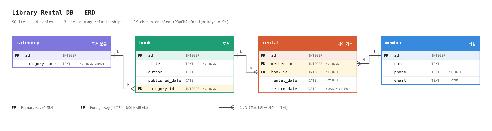

# 도서 대여 DB 실습



## 1. 엑셀과 DB의 차이
엑셀은 필요한 정보를 한 표에 모두 적어야 해서, 같은 회원 정보를 대여 기록마다 반복해서 쓰게 된다.
DB는 회원, 도서, 카테고리, 대여 기록을 테이블로 나누고 FK로 연결하기 때문에 같은 정보를 한 번만 저장한다.
그래서 정보가 바뀌면 한 곳만 고치면 되고, FK 제약조건이 존재하지 않는 값을 참조하는 입력도 막아준다.

## 2. PK와 FK
PK(기본키)는 테이블에서 각 행을 구별하는 식별자이고, FK(외래키)는 다른 테이블의 PK를 가리켜 두 테이블을 연결하는 참조이다.
예를 들어 `rental.member_id`는 FK로 `member.id`(PK)를 가리킨다.

## 3. INNER JOIN과 LEFT JOIN
INNER JOIN은 양쪽 테이블에 짝이 있는 행만 결과에 남긴다.
LEFT JOIN은 왼쪽 테이블의 행을 모두 남기고, 오른쪽에 짝이 없으면 그 자리를 NULL로 채운다.
예를 들어 책이 한 권도 없는 `총류` 카테고리는 INNER JOIN(5번 쿼리)에서는 빠지고, LEFT JOIN(6번 쿼리)에서는 책 제목이 NULL인 행으로 남는다.

## 4. 테이블 분리와 역할 분담
같은 정보를 여러 곳에 반복해서 저장하지 않도록, 하나의 대상(회원, 도서, 분류, 대여 기록)마다 테이블을 하나씩 두었다.

| 테이블 | 역할 |
|---|---|
| member | 회원 정보 (이름, 연락처, 이메일) |
| category | 도서 분류 목록 (KDC 10개 대분류) |
| book | 도서 정보, 어느 분류에 속하는지 |
| rental | 누가 어떤 책을 언제 빌리고 반납했는지의 기록 |

회원은 여러 책을 빌릴 수 있고 책도 여러 사람에게 빌려질 수 있다.
`rental`이 이 둘 사이를 이어주는 테이블이라서, 회원과 책의 정보는 한 번만 저장하고 대여 기록에는 번호만 남긴다.

## 5. FK의 의미
| FK | 도메인 의미 |
|---|---|
| book.category_id → category.id | 책은 반드시 하나의 분류에 속한다 |
| rental.member_id → member.id | 대여 기록은 어느 회원의 것인지 가리킨다 |
| rental.book_id → book.id | 대여 기록은 어느 책을 빌린 것인지 가리킨다 |

예시: 회원 1번(김민준)이 도서 1번(시간의 조각들)을 2026-08-03에 빌려서 2026-08-17에 반납했다.
이 한 줄이 `rental`에 `member_id=1, book_id=1`로 저장된다.

## 6. 제약조건을 건 이유
- `member.email` UNIQUE: 같은 이메일로 중복 가입하지 못하게 한다.
- `category.category_name` UNIQUE: 같은 분류가 두 번 만들어지지 않게 한다.
- `member.name`은 UNIQUE로 하지 않았다. 동명이인이 있을 수 있기 때문이다 (김민준 2명).
- `member.phone`, `book.title`, `book.category_id`, `rental.member_id`, `rental.book_id`, `rental.rental_date` NOT NULL: 없으면 데이터가 의미를 잃는 필수 값이다.
- `rental.return_date`는 NULL을 허용한다. NULL이면 아직 반납하지 않은 상태이다.

## 7. 컬럼 타입을 고른 이유
- `id`, FK: INTEGER. 번호이고 자동으로 증가한다 (AUTOINCREMENT).
- 이름, 제목, 저자, 이메일: TEXT. 글자이다.
- `phone`: TEXT. 앞자리 0과 하이픈(`010-...`)이 있고 계산에 쓰지 않는다.
- 날짜: DATE. 의미에 맞춰 선언했고, SQLite는 `'YYYY-MM-DD'` 글자로 저장한다. 이 형식은 글자 순서가 날짜 순서와 같아서 정렬과 비교가 된다.

## 8. 삭제 정책
`ON DELETE` 동작을 따로 지정하지 않아서 SQLite의 기본값(NO ACTION)이 적용된다.
자식(`rental`)이 가리키는 부모(`member`, `book`)를 지우려 하면 `FOREIGN KEY constraint failed`로 막힌다.
`CASCADE`를 쓰면 부모를 지울 때 대여 기록까지 말없이 사라지므로, 이 과제에서는 쓰지 않았다.

## 9. 테이블별 행 수와 샘플 데이터 원칙
| 테이블 | 행 수 (data.sql 기준) |
|---|---|
| category | 10 |
| member | 12 |
| book | 12 |
| rental | 14 |

- category는 실제 도서관에서 쓰는 한국십진분류법(KDC) 10개 대분류를 사용했다.
- member의 이름과 연락처는 가상이고, 이메일은 `example.com` 도메인으로 만들었다. 동명이인(김민준 2명)을 일부러 넣어서 이름이 아니라 `id`로 구별하는 걸 연습했다.
- book의 제목과 저자는 가상이고, 각 책의 분류는 제목과 어울리게 지정했다. `총류`에는 책이 없는데, LEFT JOIN 연습용이다.
- rental은 반납 완료 8건과 대여 중(`return_date`가 NULL) 6건이고, 회원 10~12번은 대여 기록이 없다. 대여 없는 회원 찾기를 연습하기 위해서다.
- member 행 수는 `queries.sql`의 15번 DELETE를 실행하면 11이 된다.

## 10. 쿼리와 요구사항 매핑
| 요구사항 | 쿼리 번호 | 사용한 문법 |
|---|---|---|
| 기본 조회 4개 이상 | 1, 2, 3, 4 | WHERE, ORDER BY, LIMIT, AND, LIKE |
| 조인 4개 이상 (INNER 2개, LEFT 1개 이상) | INNER: 5, 7 / LEFT: 6, 8 | INNER JOIN, LEFT JOIN, IS NULL |
| 집계 3개 이상 (COUNT, SUM, AVG 중 2종 + GROUP BY) | 9, 10, 11 (COUNT) / 12 (AVG) | GROUP BY, COUNT, AVG |
| 서브쿼리 1개 이상 | 13 | NOT IN |
| 수정, 삭제 | 14 (UPDATE) / 15 (DELETE) | UPDATE, DELETE |
| 인덱스 + 적용 이유 | 16 | CREATE INDEX |

## 11. 인덱스 후보
현재는 `rental.member_id`에 인덱스를 만들었다. 회원별 대여 조회(7, 8, 11, 12번 쿼리)에서 이 컬럼을 JOIN과 GROUP BY에 자주 쓰기 때문이다.
다음 후보는 `rental.book_id`(책별 대여 조회)와 `book.category_id`(분류별 책 조회)이다.
지금 데이터는 행이 수십 개뿐이라 속도 차이를 체감할 수 없지만, 행이 수만 건 이상으로 늘면 전체를 훑지 않고 바로 찾을 수 있어서 효과가 크다.
다만 인덱스는 INSERT, UPDATE, DELETE 때 같이 갱신해야 하므로 필요한 컬럼에만 만든다.

## 12. 작업 중 만난 문제와 해결
- **문장 끝 `;` 누락**: `CREATE TABLE`을 여러 개 이어 실행하자 `near "CREATE": syntax error`가 났다. 모든 문장 끝에 `;`를 붙여 해결했다.
- **주석 줄의 `--` 누락**: 여러 줄 주석에서 둘째 줄부터 `--`를 빼먹어 `unrecognized token: "8번"`이 났다. 모든 줄 앞에 `--`를 붙여 해결했다.
- **에러 없이 틀린 쿼리**: 1번 쿼리에서 `name =`을 빼먹었더니 에러 없이 결과가 0줄이었다. 에러가 없어도 결과 행 수까지 확인하도록 바꿨다.
- **변경사항 저장 누락**: DB Browser에서 INSERT 후 저장하지 않고 창을 닫아 데이터가 사라졌다. 변경사항 저장(Ctrl+S)을 누르도록 했다.
- **FK 에러**: 자식(`rental`)이 가리키는 `member` 1번을 지우려 하자 `FOREIGN KEY constraint failed`가 났다. 자식을 먼저 지우고 부모를 지워야 한다.

## 13. 복잡한 쿼리 단계별 설명 (7번: 대여 기록별 회원 이름, 책 제목, 대여일)

```sql
SELECT member.name, book.title, rental.rental_date
FROM rental
INNER JOIN member ON rental.member_id = member.id
INNER JOIN book   ON rental.book_id = book.id;
```

1. `FROM rental`: 대여 기록 14건에서 시작한다. 여기에는 회원과 책이 번호로만 들어 있다.
2. `INNER JOIN member ON rental.member_id = member.id`: 각 대여 기록의 `member_id`와 같은 `id`를 가진 회원 행을 이어 붙인다. 이제 한 행에 회원 이름이 생긴다.
3. `INNER JOIN book ON rental.book_id = book.id`: 같은 방식으로 `book_id`와 같은 `id`의 책 행을 이어 붙인다. 이제 한 행에 책 제목도 생긴다.
4. `SELECT member.name, book.title, rental.rental_date`: 이어 붙은 결과에서 보고 싶은 컬럼 3개만 골라서 보여준다.

각 단계를 거치며 `rental` 14행이 짝이 있는 행만 남기 때문에, 결과도 14행이 된다 (모든 대여 기록에 회원과 책이 있다).